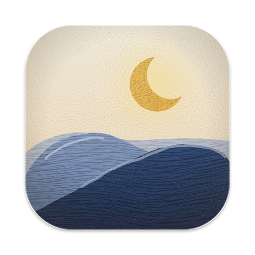

<p align="center">
  
</p>

<h1 align="center">Lune</h1>

<p align="center">
  A personal fork of <a href="https://github.com/mantrakp04/ardia">Ardia</a>, the macOS browser with Arc's sidebar and Dia's polish on real Chromium.<br>
  Built from source on your own Mac. No account, no telemetry, no update server.
</p>

## What's different from Ardia

- **Collapse to icons.** Settings › Tabs › Sidebar button: *Hides the sidebar* (Ardia's behaviour) or *Collapses to icons*. Collapsed, ⌘S and the sidebar button shrink the sidebar to a 72 pt rail of pinned tiles and tab icons. Hover an icon for its card, and swipe sideways on the rail to switch profiles.
- **Roomier sidebar.** Tab rows are 38 pt tall with 4 pt between them (Ardia matches Dia's 34 and 3).
- **A quieter address field.** In the sidebar layout, the address sits in a soft tint with no outline.
- **A livelier hover card.** The favicon sits in a tile, the buttons rise in one after another, lift on hover and squeeze when pressed.
- **Theme editor.** A reworked theme editor with gradient and Liquid Glass looks.
- **Its own name and icon.** Lune everywhere you look, and a painted crescent over blue hills, in the style of Ardia's sun.
- **Nothing phones home.** No update feed, no remote kill switches, no telemetry or crash reports, no release-notes page after updates. Feedback and source links point to this repo.

Everything else is Ardia's: profiles, split view, Little Lune (⌥⌘N), the command bar, uBlock Origin built in, the Chrome Web Store, iCloud sync, importers and the rest. The feature-by-feature list is in [docs/dia-feature-parity.md](docs/dia-feature-parity.md).

## It's actually Chromium

Not WebKit, not Electron. Every window is Chrome's own (Chromium 155 through Ardia's engine, built on [Helium](https://github.com/imputnet/helium)), so sites, extensions and DevTools behave as they do in Chrome. Apple Silicon only.

---

# Build it yourself

```
apps/
  browser/            Expo + react-native-macos app (UI in src/, Xcode project in macos/)
packages/
  ardiacore/          The engine: Chromium 155's framework with Ardia's layer (Chrome tabs hosted in our views), JS API in src/
  shell/              Native menu bar + shortcuts → JS, windows, SF Symbols, native primitives
  shaders/            Metal: New Tab effects + grained OKLab window backdrop
  import/             Import from other browsers (bookmarks, history, passwords, Arc spaces)
  sync/               End-to-end encrypted sync through your own iCloud Drive
  core/               Pure TS: omnibox input → URL, suggestions, breadcrumbs (tested)
```

## Run it

Requires Xcode 26+, CocoaPods, Node 22.13+ (pinned in `.nvmrc`), pnpm 11, and an Apple Silicon Mac.

```bash
pnpm install
pnpm pods
```

**The engine.** Building Chromium yourself takes hours and a large source tree, so use the prebuilt engine that Ardia
publishes with its releases. `packages/ardiacore/prebuilt-engines.tsv` maps each `engine/` tree to one, and
`packages/ardiacore/scripts/fetch-engine.sh` downloads it into `apps/browser/build-ardiacore/prebuilt/<hash>/`
(`--nearest` takes the newest one if your tree has moved past the last release).

**Metro**, in one terminal:

```bash
pnpm dev
```

**The app**, in another (from `apps/browser`). Without Ardia's Apple team, sign ad hoc, point the build at the
prebuilt engine, and use a copy of `macos/Ardia-macOS/Ardia.entitlements` without the `keychain-access-groups` key
(an ad-hoc app with that key is killed at launch):

```bash
ARDIACORE_FRAMEWORK="$PWD/build-ardiacore/prebuilt/<hash>/Chromium Framework.framework" \
xcodebuild -workspace macos/Ardia.xcworkspace -scheme Ardia-macOS -derivedDataPath build-lune \
  -destination 'platform=macOS,arch=arm64' -configuration Debug -quiet \
  CODE_SIGN_IDENTITY=- CODE_SIGN_STYLE=Manual DEVELOPMENT_TEAM= PROVISIONING_PROFILE_SPECIFIER= \
  CODE_SIGN_ENTITLEMENTS=<path to that entitlements copy>
```

**Launch it.** A Debug build needs a data folder and quits at once without one, so a double-click or Finder's Open With
does nothing:

```bash
open -n --env ARDIA_DATA_DIR="$HOME/Library/Application Support/Ardia Dev" \
  apps/browser/build-lune/Build/Products/Debug/Lune.app
```

Once it's running, Open With and dragging files onto its Dock icon work. The interface reloads from Metro as you edit;
native changes need a rebuild. Passwords, passkeys and saved cards need a real signing team, so they don't work in an
ad-hoc build.

Checks: `pnpm --filter @ardia/browser typecheck`, and the tests with
`cd apps/browser && node --no-warnings --import ./src/test-loader.mjs --test "src/**/*.test.mjs"`.

Shortcuts: ⌘T new tab, ⌘L command bar, ⌘W close, ⇧⌘T reopen, ⌘S sidebar, ⌘[ / ⌘] back/forward,
⌘R reload, ⌘1–⌘9 select tab, ⌃Tab cycle.

## Keeping up with Ardia

Lune gets its security fixes from Ardia's engine, so merge Ardia regularly:

```bash
git fetch upstream
git merge upstream/main
git push origin main
```

`origin` is this repo and `upstream` is [mantrakp04/ardia](https://github.com/mantrakp04/ardia). After a merge, fetch
the prebuilt engine that matches the new `engine/` tree and rebuild. Lune is only as current as its last merge, and
it depends on Ardia continuing to publish prebuilt engines.

**Where the name lives.** The interface reads it from `APP_NAME` in `apps/browser/src/lib/appName.ts`, and native code
from the bundle name (`PRODUCT_NAME` in the Xcode project). The bundle id is `com.chaseballard.lune`. Keychain items
("Ardia Safe Storage" and friends) and the "Ardia Sync" iCloud folder keep Ardia's names on purpose: they identify
existing data, and the engine expects them.

## How Dia's New Tab light works

Dia 1.50 turns this light off along with its rebrand (a painted mark, a single-colour power-up band
and a halo around the bar; `docs/dia-spec.md` › "1.50 Sunglow"), and so does Lune (as Ardia did). The
reconstruction left the tree with it: `git show f2c0e251:packages/shaders/ios/AreaLightView.swift`.

These findings come from disassembling the Metal libraries in `Dia.app` (v1.49.1) with
`xcrun metal-objdump`. `BoostBrowser_PowerUp.bundle/default.metallib` contains
`breathingAreaLightFragment`, which the Swift class `NewTabPage.NewTabAreaLightView` hosts. The
reconstruction was `AreaLightView.swift` (above).

- **The command bar is a light source.** Dia models the bar as a rounded-rectangle area light floating
  `lift` points above the page. Each pixel receives the closed-form irradiance of that rectangle: the
  solid-angle formula, one `atan` term per corner, times 1/2π. Rounded corners subtract (1 − π/4) of
  each corner square. The result is a physically correct penumbra: a higher lift gives a softer, wider
  glow.
- **Falloff** is reshaped from inverse-square to `(h/d)^falloff`, where `d` is the distance to the
  emitter's rounded-rect surface rather than to its centre.
- **Colour** is Dia's brand spectrum (`ProgressBarColor2…7` in its asset catalog):
  blue `#0358F7`, steel `#5092C7`, lavender `#E1E1FE`, yellow `#FFD400`, orange `#FA3D1D` and magenta
  `#FD02F5`. It is laid out as a wrapping, slightly diagonal gradient that scrolls every 20 s. IQ's 2D
  simplex noise warps the gradient under the bar, and the warp fades out into the penumbra.
- **Dark mode** treats the light as HDR emission and applies the Hable/Uncharted-2 filmic tonemap
  (white point 11.2), with alpha set to Rec.709 luminance. **Light mode** keeps the flat palette
  colour and uses the irradiance as opacity.
- **Finishing:** alpha fades over the top 50 pt and bottom 200 pt of the view, and ±3/255 triangular
  dither (Dave Hoskins' `hash12`) prevents banding in the long soft falloff.
- **Animation:** the shader itself only scrolls the colours. The lift-off intro and the slow
  "breathing" come from the CPU, which animates `lift` and `intensity`. Those curves live in Dia's
  Swift code, so the ones here (quartic ease-out over 1.1 s, ±7% intensity on a 5.5 s sine) are my
  approximation.

The **window backdrop** comes from `ARC_WindowThemeUI.bundle`
(`gradientFragment` + `renderFragment`). Gradient stops are stored and mixed in **OKLab**, then
converted to linear sRGB and gamma-encoded in the shader. A tiled grain texture is then
multiply-blended on top. `WindowBackdropView` does the same with procedural grain.

Only math and colour values are reused. No Dia images, fonts or binaries are copied into this repo.

## Architecture notes

- **Why Expo SDK 54:** `react-native-macos` tops out at 0.81, which pairs with Expo SDK 54 (whose
  `ExpoAppDelegate` / `ExpoReactNativeFactory` have macOS code paths).
- **Legacy architecture.** react-native-macos 0.81's Fabric support is experimental, so the app runs on
  the legacy architecture. One consequence: Expo's legacy view-manager adapter instantiates a module's
  *first* view class for every view it declares, so each native view has its own module.
- **Metro, not `expo start`.** Metro runs through the react-native-macos CLI. `metro.config.js`
  redirects `react-native` → `react-native-macos` for `platform=macos`, because defining our own
  `resolveRequest` replaces the redirect the CLI would install.
- **No Reanimated.** It has no macOS build for 0.81; animations use RN's `Animated`.
- **Monorepo paths.** pnpm is set to `nodeLinker: hoisted` because CocoaPods and Metro resolve
  `react-native-macos` by path. The Podfile rewrites `REACT_NATIVE_PATH` to the hoisted location and
  raises every pod's deployment target to 14.0, since Xcode 26+ rejects the 11.0 some Expo pods declare.
- **Native subviews** are sized in `setFrameSize`, not `layout()`. RN macOS assigns frames directly and
  never autoresizes subviews.
- **Shaders** are Metal source embedded in Swift and compiled at runtime (once per class, cached). This
  keeps the pods free of a metallib build phase.

## License

Lune is a fork of [Ardia](https://github.com/mantrakp04/ardia) by Mantra Patel. As distributed it is licensed under the
[GNU General Public License v3](LICENSE), because its engine is built with GPL-3.0 patches; Ardia's own source files are
under the [Apache License 2.0](LICENSE.Apache-2.0). It builds on Chromium and Helium, carries a few of the Chromium
Embedded Framework's patches to Chromium (BSD-3-Clause), and bundles uBlock Origin, each under its own license; see
[NOTICE](NOTICE). "Ardia" is the original project's name; Lune is not affiliated with it.
